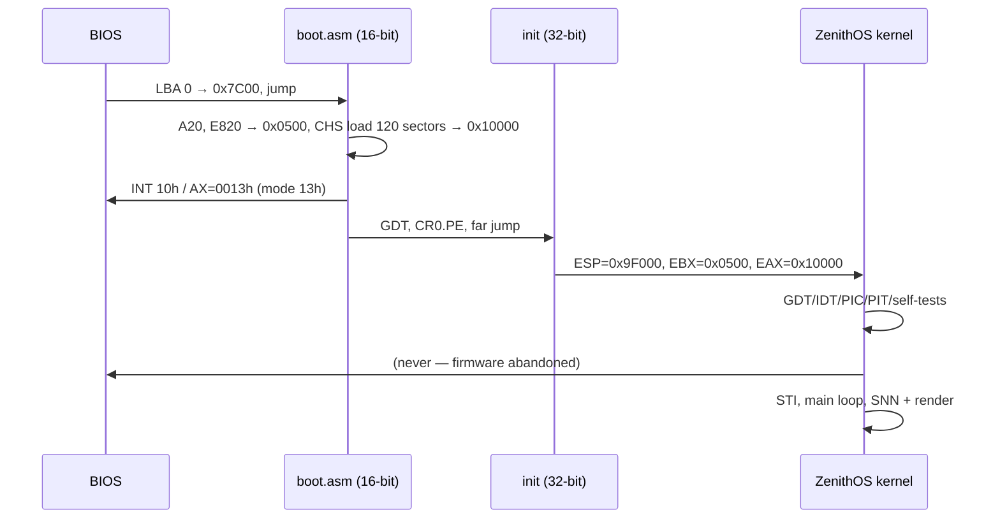

# ZenithOS

**A bare-metal, AI-native 32-bit x86 operating system. 512-byte boot sector. 60 KiB kernel. A spiking neural network in ring 0 driving a neon neural-mesh desktop.**

[](https://github.com/doujiaozh/zenith-os/actions/workflows/build.yml)
[](LICENSE.md)
[](#architecture)
[](#quick-start)
[](#quick-start)
[](docs/AI-NATIVE.md)
[](docs/ARCHITECTURE.md)

```text
    ███████╗███████╗███╗   ██╗██╗████████╗██╗  ██╗ ██████╗ ███████╗
    ╚══███╔╝██╔════╝████╗  ██║██║╚══██╔══╝██║  ██║██╔═══██╗██╔════╝
      ███╔╝ █████╗  ██╔██╗ ██║██║   ██║   ███████║██║   ██║███████╗
     ███╔╝  ██╔══╝  ██║╚██╗██║██║   ██║   ██╔══██║██║   ██║╚════██║
    ███████╗███████╗██║ ╚████║██║   ██║   ██║  ██║╚██████╔╝███████║
    ╚══════╝╚══════╝╚═╝  ╚═══╝╚═╝   ╚═╝   ╚═╝  ╚═╝ ╚═════╝ ╚══════╝
```

> **v1.0 "Neural Core"** — the whole operating system is 1,474,560 bytes of raw
> floppy image, and 61,440 of those bytes are a hard kernel budget. There is no
> libc, no filesystem, no network stack, and no model weights. There is a
> bootloader, a protected-mode kernel, a deterministic 24-neuron spiking neural
> network, and a double-buffered 320×200 neon desktop that reacts to every key
> you press.

---

## 中文简介（Chinese summary）

ZenithOS 是一个**从零编写的裸机 32 位 x86 操作系统**：512 字节引导扇区从
1.44 MB 软盘镜像启动，把不超过 60 KiB 的内核加载到物理地址 `0x10000`，进入
保护模式后建立 GDT/IDT、重映射 8259 PIC、以 100 Hz 的 PIT 作为心跳，并运行一个
**确定性的 24 神经元脉冲神经网络（SNN）**。SNN 的激活状态直接驱动一个
320×200、256 色的霓虹“神经核心”桌面：24 个旋转的 3D 神经元（双环 + 4 个轴节点
+ 4 个核心节点）、40 条突触边、12 个数据包、72 颗确定性星点、透视地面网格、
扫描线调色板与实时 HUD。键盘由 IRQ1 中断驱动，`W/S` 控制景深、`A/D` 偏航、
`Q/E` 俯仰、`R` 重置、`C` 切换电影式自动旋转、`Space` 加速，方向键镜像缩放/
偏航。

v1.0 同时包含：E820 物理页位图分配器（PMM）、自由链表堆、统一日志
（COM1 + 32 条内存环形缓冲）、**10 项开机自检**（boot-info、GDT、IDT、PMM、
堆、SNN、RTC、PIT 中断投递、VGA 后备缓冲、`INT 0x80` ABI）、异常与崩溃
屏幕（KERNEL PANIC：向量号/名称、错误码、出错 EIP、CR2、CR0，并先把完整
记录写入 COM1）、确定性的 `node build.js` 构建（NASM 逐模块编译门禁、Q8.8
正弦/余弦表与 256 色调色板生成、镜像回读校验、SHA-256），以及基于 v86 的
无头启动截图测试。

**诚实边界：** v1.0 **没有**分页/MMU 隔离、ring 3 用户态、进程与调度器、
文件系统、网络、POSIX 系统调用、SMP、ACPI 或持久化存储；所有代码运行在
ring 0 的单一地址空间中。它不是生产系统，而是一个可完整阅读、可复现、
以 AI 为核心的 OS 研究项目。完整路线图见 [ROADMAP.md](ROADMAP.md)，安全模型见
[docs/SECURITY.md](docs/SECURITY.md)。

---

## Table of contents

- [Why ZenithOS](#why-zenithos)
- [AI-native, precisely](#ai-native-precisely)
- [Quick start](#quick-start)
  - [Windows](#windows)
  - [Linux](#linux)
  - [macOS](#macos)
  - [Run under QEMU](#run-under-qemu)
  - [Headless verification with v86](#headless-verification-with-v86)
- [Screenshots](#screenshots)
- [Architecture](#architecture)
  - [Boot timeline](#boot-timeline)
  - [Memory map](#memory-map)
  - [Module map](#module-map)
  - [Interrupts and I/O path](#interrupts-and-io-path)
  - [Rendering and math pipeline](#rendering-and-math-pipeline)
- [Performance budget](#performance-budget)
- [Security model](#security-model)
- [Testing and verification](#testing-and-verification)
- [Repository layout](#repository-layout)
- [Design principles: charter → v1.0 → roadmap](#design-principles-charter--v10--roadmap)
- [Versioning and roadmap](#versioning-and-roadmap)
- [Governance and compliance](#governance-and-compliance)
- [Contributing](#contributing)
- [Licence](#licence)
- [Acknowledgements](#acknowledgements)
- [FAQ](#faq)

---

## Why ZenithOS

Modern operating systems are extraordinary engineering artifacts built on
decades of accumulated assumptions: millions of lines of code, dozens of
subsystems, opaque firmware, cloud dependencies, and an implicit contract that
the user's machine is a terminal for someone else's datacenter.

ZenithOS asks a different question:

> What does an operating system look like if it is designed around a
> deterministic, local intelligence — and if every byte of it must be
> justified by the machine it runs on?

That question produces a very small answer with very large ambitions:

- **Small enough to understand.** The kernel is measured in tens of
  kilobytes, in NASM, with a documented memory map and no hidden runtime.
- **Reliable by construction.** The build validates the boot signature, the
  512-byte sector, the kernel budget, the image size, and every payload byte
  after writing. Boot self-tests check the core subsystems. CPU faults reach a
  diagnosable panic screen instead of a silent hang.
- **Deterministic.** No randomness, no floating point in the model, no
  wall-clock dependence. The same build and the same inputs produce the same
  frames.
- **AI-native.** The spiking network is a kernel subsystem whose state *is* the
  desktop. Not a chat box. Not a cloud API. A closed perception loop from timer
  and keyboard to pixels.
- **Honest about its limits.** v1.0 is not POSIX, not multi-user, not
  network-connected, not secure in the isolation sense, and not production
  ready. The documentation says so on every page.

The long-term charter — modular microkernel, extreme reliability, secure by
default, top-tier performance, POSIX compatibility, a thriving ecosystem,
exceptional UX, hardware co-design, AI-native design, unified logging, open
governance, global compliance, and continuous innovation — is mapped to
concrete work in the [design principles table](#design-principles-charter--v10--roadmap)
and in [ROADMAP.md](ROADMAP.md).

---

## AI-native, precisely

"AI-native" is a term that deserves skepticism. In ZenithOS it means one
specific, testable thing:

> A 24-neuron spiking neural network (`src/ai/snn.asm`) runs inside the kernel,
> consumes the 100 Hz timer and keyboard events as its only senses, and emits
> activations that directly control the visual state of the desktop.

| Property | v1.0 implementation |
| --- | --- |
| Model | Leaky integrate-and-fire SNN, 24 neurons, 8-bit saturating integer state |
| Clock | 8254 PIT, IRQ0, 100 Hz (`PIT_HZ 100`) |
| Dynamics | 12.5% leak per tick; 1-in-8 ambient stimulus of +72; key stimulus of +96 |
| Senses | Timer ticks; keyboard scancodes injected as stimulus |
| Threshold | `SNN_THRESHOLD 192` (8-bit activation) |
| Statistics | Total spike count, per-tick spike count, energy = Σ activation (≤ 6120) |
| Determinism | Fixed-seed xorshift32 (0x13579BDF), fixed update order, no FPU |
| Action | Neuron glow/radius, synapse brightness, travelling packets, HUD metrics |
| Privacy | No network, no storage, no telemetry — inference cannot leave the machine |
| Auditability | The model is assembly source in the repository; no opaque weights |

The loop is closed and local:

```text
  timer IRQ0 (100 Hz) ─┐
                       ├──> SNN update ──> activation field ──> projection
  keyboard IRQ1 ───────┘         ^                                  │
                                 │                                  v
                            your keys <── human <── VGA framebuffer <── blit
```

Read the full essay: [`docs/AI-NATIVE.md`](docs/AI-NATIVE.md). The model's
exact topology, weights, and update rules are documented in
[`docs/ARCHITECTURE.md`](docs/ARCHITECTURE.md#10-the-spiking-neural-network).

---

## Quick start

**Prerequisites:** [Node.js](https://nodejs.org/) 18+ and NASM 2.16.01. QEMU is
optional but recommended. The OS build has **no npm dependencies**.

### Windows

```bat
:: from the repository root
node build.js
qemu-system-i386 -fda zenithos.img -boot a
```

If `nasm.exe` is not on `PATH`, place it next to `build.js` (the repository root
already expects a local copy) or set `NASM=C:\path\to\nasm.exe`.

### Linux

```bash
sudo apt install nasm qemu-system-x86 nodejs   # Debian/Ubuntu
# or: sudo dnf install nasm qemu-system-x86 nodejs  # Fedora
node build.js
qemu-system-i386 -fda zenithos.img -boot a
```

### macOS

```bash
brew install nasm qemu node
node build.js
qemu-system-i386 -fda zenithos.img -boot a
```

`build.js` locates NASM via the `NASM` environment variable, `./nasm.exe`,
`PATH`, or common installation directories, prints the assembler version, and
fails with a clear message if it cannot find one.

### Run under QEMU

```bash
qemu-system-i386 -fda zenithos.img -boot a
# or with an explicit raw floppy drive:
qemu-system-i386 -drive format=raw,file=zenithos.img,if=floppy -boot a
```

Click the window to focus it, then:

| Key | Action |
| --- | --- |
| `W` / `S` | Dolly in / out (zoom; default 240, clamped 130–560) |
| `A` / `D` | Yaw — rotate the neural core left / right |
| `Q` / `E` | Pitch — tilt the camera up / down (clamped to ±6000 binary radians) |
| `R` | Reset camera (yaw, pitch, zoom, auto-rotation) |
| `C` | Toggle cinematic auto-rotation |
| `Space` | Boost — 3× yaw speed and 2× pitch speed |
| `↑` / `↓` | Mirror dolly in / out |
| `←` / `→` | Mirror yaw |

### Headless verification with v86

The repository ships a headless harness used by CI and by anyone who wants a
screenshot without a display:

```bash
npm install          # dev dependencies only (v86); not needed to build the OS
node tools/emulate.mjs
```

It boots `zenithos.img` under [v86](https://github.com/copy/v86), waits for the
kernel to reach its render loop, injects camera keys, captures screenshots into
`screenshots/`, and asserts that the resulting frame is non-trivial (not a
uniform colour field). See [`docs/TESTING.md`](docs/TESTING.md) for what each
check means.

### Build output

```text
build/boot.bin        512 bytes       boot sector, ends in 0xAA55
build/kernel.bin      ≤ 61,440 bytes  flat 32-bit kernel, loaded at 0x10000
build/zenithos.img    1,474,560 bytes raw 1.44 MB floppy image
zenithos.img          1,474,560 bytes identical copy at the repository root
build/report.json     machine-readable build report (modules, hashes, checks)
```

**Verified v1.0.0 release artifact** (reproducible; also recorded in
`build/report.json`):

| Artifact | Size | SHA-256 |
| --- | --- | --- |
| `build/boot.bin` | 512 B | `36e551a14909f70b51336596e5d0dacb0bf02a6b3651575f15110abc32f439a8` |
| `build/kernel.bin` | 19,376 / 61,440 B (31.5%) | `88926f1c573f234088e82687e4d9eed8f78a6a8760961268e319876ddb0b4efe` |
| `zenithos.img` | 1,474,560 B | `a5a9d9f26af8ae82429c593539f9d14059d60013dbbb3b1345758dbaf3513d13` |

---

## Screenshots

Screenshots are produced by the headless v86 harness and committed to
`screenshots/` so that every release has visual evidence, not just a changelog.
They are regenerated by `node tools/emulate.mjs`, which writes upscaled PNGs
(default 3×, configurable with `--scale`).

| File | What it shows |
| --- | --- |
| `screenshots/emu-boot.png` | The desktop after boot, captured headlessly from the VGA layers |
| `screenshots/emu-boot-before.png` | Frame before injected camera keys (`--keys`) |
| `screenshots/emu-boot-after.png` | Frame after injected camera keys — proves input reaches the loop |
| `screenshots/emu-fixture.png` | The harness self-test fixture (known VGA pattern), not the OS |
| `screenshots/font-preview.png` | The 5×7 bitmap font rendered as a printable sheet (tooling) |

The CI workflow builds the image and runs the harness on every push to `main`.
If a frame regression changes the committed screenshots, the pull request shows
the diff.

> Screenshots are captured from an emulated VGA adapter in mode 13h. The real
> palette depends on the DAC programming described in
> [`docs/ARCHITECTURE.md`](docs/ARCHITECTURE.md#12-palette-and-dac).

---

## Architecture

ZenithOS v1.0 is a **single-address-space, ring-0 kernel** in 32-bit protected
mode. It boots from a raw floppy image, owns the hardware directly, and renders
a 320×200×256 desktop with a double buffer. There is no paging, no userspace,
and no scheduler beyond interrupt handlers — the architecture is deliberately
the simplest thing that can support the AI-native UX, and it is documented so
that the v2.0 microkernel can replace pieces without mystery.

```text
                          +--------------------------------------+
                          |            BIOS firmware             |
                          | INT 13h  INT 10h  INT 15h E820/A20   |
                          +------------------+-------------------+
                                             |
                     512-byte boot sector (LBA 0, 0x7C00)
                                             |
             +-------------------------------v-------------------------------+
             | boot.asm — real mode                                          |
             |   A20 gate -> E820 map @ 0x0500 -> CHS load 120 sectors       |
             |   -> VGA mode 13h -> flat GDT -> CR0.PE -> far jump           |
             +-------------------------------+-------------------------------+
                                             |
                          32-bit protected mode, kernel @ 0x10000
                                             |
    +----------------------------------------v---------------------------------------+
    | src/kernel.asm — umbrella + main loop                                          |
    |                                                                                 |
    |  arch/          drivers/              mm/            ai/          ui/           |
    |  gdt idt isr    vga keyboard pit      pmm heap       snn          font theme    |
    |  pic syscall    serial rtc                                         neural      |
    |                                                                                 |
    |  lib/ fixed string log selftest        +-- back buffer @ 0x20000               |
    |                                        +-- PMM bitmap @ 0x30000                 |
    |                                        +-- heap arena @ 0x34000-0x6FFFF          |
    +----------------------------------------+----------------+-----------------------+
                                             |                |
                              rep movsd blit |                | serial COM1 + log ring
                                             v                v
                                   VGA framebuffer      HUD / panic / logger
                                   0xA0000 (mode 13h)
```

### Boot timeline

The boot path is a single 512-byte real-mode sector. It is worth reading the
actual source: [`boot.asm`](boot.asm) is 275 lines and commented line by line.

| Step | What happens | Where |
| --- | --- | --- |
| 1 | BIOS loads LBA 0 to `0000:7C00` and jumps to it | firmware |
| 2 | `CLI`; segments zeroed; stack at `0x7C00`; boot drive saved from `DL`; `CLD` | `boot_main` |
| 3 | A20 enabled: fast test, then BIOS `INT 15h AX=2401h`, then port `0x92`; each verified with the `0x100500`/`0x000500` alias test | `enable_a20` |
| 4 | BIOS `E820` probe writes up to 8 entries of 24 bytes to `0x0510`, count at `0x0506` | `e820_probe` |
| 5 | Kernel loaded sector-by-sector over CHS (cylinder 0/head 0/sector 2 onward, then head 1, then next cylinder) to `0x10000`; 3 retries + controller reset per sector | `load_kernel` |
| 6 | VGA mode 13h selected (`INT 10h AX=0013h`) — while the BIOS is still available | `boot_main` |
| 7 | Boot-info block written at `0x0500`: magic `ZENO`, version `1`, drive byte | `boot_main` |
| 8 | Flat GDT loaded; `CR0.PE` set; far jump `0x08:pm_entry` | `boot_main` |
| 9 | Segments set to `0x10`; `ESP = 0x9F000`; `EBX = 0x0500`; `EAX = 0x10000`; jump to kernel | `pm_entry` |
| 10 | Kernel installs GDT/IDT/PIC/PIT/keyboard/VGA, logs to COM1, enables interrupts (`STI`), runs 10 boot self-tests, enters the render loop | `src/kernel.asm` |



**Firmware is abandoned after the protected-mode jump.** No BIOS call happens
in 32-bit mode. The kernel is entirely self-contained.

### Memory map

Single source of truth: [`src/include/config.inc`](src/include/config.inc).
The loader and the kernel include the same header, which prevents drift.

| Range | Size | Use |
| --- | --- | --- |
| `0x000000–0x0003FF` | 1 KiB | Real-mode interrupt vector table (unused after boot) |
| `0x000400–0x0004FF` | 256 B | BIOS data area (unused after boot) |
| `0x000500–0x00050F` | 16 B | Boot-info block: magic `ZENO`, version, drive, E820 entry count |
| `0x000510–0x0005CF` | 192 B | BIOS E820 entries (max 8 × 24 B) |
| `0x0007C00–0x0007DFF` | 512 B | Boot sector while it executes (dead afterward) |
| `0x0010000–0x001EFFF` | 60 KiB max | Flat 32-bit kernel image (`KERNEL_ORG`) |
| `0x0020000–0x002F9FF` | 64,000 B | VGA back buffer (`VGA_BACKBUF`) |
| `0x0030000–0x0033FFF` | 16 KiB | PMM page bitmap (131,072 pages → 512 MiB of physical RAM) |
| `0x0034000–0x006FFFF` | ~304 KiB | Kernel heap arena (`HEAP_START` … `HEAP_END`) |
| `0x0070000` | — | AI scratch base (`AI_SCRATCH`) |
| `0x0074000` | — | UI scratch base (`UI_SCRATCH`) |
| `0x009F000` | — | Kernel stack top (`KERNEL_STACK_TOP`, grows down) |
| `0x00A0000–0x00AF9FF` | 64,000 B | VGA mode 13h framebuffer (`VGA_FB`) |
| `0x00F0000+` | — | BIOS ROM / memory-mapped firmware (not touched) |

> Sizes marked "—" are bases whose extents are owned by the subsystem that uses
> them; see the module sources. The PMM bitmap is sized to track 512 MiB of
> physical memory, of which the first 1 MiB is reserved by construction.

### Module map

| Path | Responsibility | Key interfaces (source-of-truth names) |
| --- | --- | --- |
| `boot.asm` | 512-byte real-mode bootstrap: A20, E820, CHS load, VGA mode, GDT, PM entry | `BOOTINFO_ADDR`, `KERNEL_ORG`, `KERNEL_STACK_TOP` |
| `src/kernel.asm` | Umbrella TU, `kernel_entry` (image offset 0 holds a `jmp` vector), subsystem init, main loop | includes all modules |
| `src/include/config.inc` | Loader/kernel ABI and physical memory map | `KERNEL_ORG`, `VGA_*`, `PMM_*`, `SNN_*` |
| `src/include/macros.inc` | `OUTB`/`INB`/`IO_DELAY`/`ASSERT_NOT_ZERO` assembler macros | no emitted code |
| `src/arch/gdt.asm` | Flat GDT installation / reload | `init_gdt` |
| `src/arch/idt.asm` | 256-gate IDT, gate installation, dispatch table | `init_idt` |
| `src/arch/isr.asm` | CPU exception stubs, IRQ stubs, common dispatch, panic | exception/IRQ entry |
| `src/arch/pic.asm` | 8259 remap to `0x20`/`0x28`, mask/unmask, EOI | `pic_*` |
| `src/arch/syscall.asm` | `INT 0x80` DPL-3 gate and native 5-call ABI (ticks, serial write, SNN energy, heap used, PMM free KiB) | `syscall_init`, call numbers 0–4 |
| `src/lib/panic.asm` | Exception report: serial record, panic screen, exception-name table | `exception_panic` |
| `src/drivers/vga.asm` | Mode 13h back-buffered primitives, DAC palette, text | pixel/line/rect/blit/text |
| `src/drivers/keyboard.asm` | IRQ1, scancode set 1, ring buffer, key state | ring buffer, key query |
| `src/drivers/pit.asm` | 8254 channel 0 at 100 Hz, tick counter, uptime | `PIT_HZ`, tick counter |
| `src/drivers/serial.asm` | COM1 16550 initialisation and byte output | `SERIAL_PORT` |
| `src/drivers/rtc.asm` | CMOS real-time clock read (time/date) | RTC registers |
| `src/mm/pmm.asm` | E820-driven physical page bitmap allocator | `PMM_BITMAP_ADDR`, `PMM_MAX_PAGES` |
| `src/mm/heap.asm` | Free-list kernel heap (`kmalloc`/`kfree`) in the static arena | `HEAP_START`, `HEAP_END` |
| `src/ai/snn.asm` | Deterministic 24-neuron spiking neural network | `SNN_NEURONS`, `SNN_THRESHOLD` |
| `src/ui/font.asm` | 5×7 bitmap font, ASCII 32–126 (95 glyphs × 5 bytes) | `font_5x7` |
| `src/ui/theme.asm` | Cyberpunk palette, colour ramps, scanline constants | palette tables |
| `src/ui/neural.asm` | 3D neural-mesh desktop: projection, edges, packets, HUD | render entry |
| `src/lib/fixed.asm` | Fixed-point helpers (Q8.8/Q16.16, sin/cos table lookup) | fixed-point routines |
| `src/lib/string.asm` | `memset`/`memcpy`/`strlen`-style helpers | libc-like helpers |
| `src/lib/log.asm` | Unified logger: levels, timestamps, COM1 + in-memory ring | `log_*` |
| `src/lib/selftest.asm` | 10 boot self-tests: boot-info, GDT, IDT, PMM, heap, SNN, RTC, PIT delivery, VGA buffer, `INT 0x80` | self-test report |
| `build.js` | NASM discovery, trig generation, module gate, image pack/verify, SHA-256, report | CLI |
| `tools/emulate.mjs` | Headless v86 boot, key injection, screenshot capture, frame assertion | CLI |

The build enumerates **every** `.asm` file under `src/` except the umbrella and
assembles it independently with `-DZENITH_OBJ_CHECK`. A module that references
something it does not declare fails the gate before the flat kernel is built.
That is the project's structural defence against silent coupling.

### Interrupts and I/O path

| Vector | Source | Handler behaviour |
| --- | --- | --- |
| `0x00–0x1F` | CPU exceptions | Named panic screen: vector + name, error code, faulting `EIP`, `CR2`, `CR0`; full record to COM1; halts deterministically |
| `0x20` | PIC IRQ0 / PIT | Increment the 100 Hz tick counter; advance the SNN clock |
| `0x21` | PIC IRQ1 / keyboard | Read scancode set 1, translate, push into the 64-entry ring, update key state |
| `0x80` | Software trap | Native call ABI (5 calls: ticks, serial write, SNN energy, heap used, PMM free KiB); gate installed DPL 3, self-tested from ring 0. **Not POSIX.** |
| others | Masked / `isr_unused` | Unused gates return quietly; unexpected interrupts are reported rather than ignored |

```text
  8254 PIT ──IRQ0──> 8259 master ──> IDT[0x20] ──> isr stub ──> pit_tick++
                                                        │
                                                        └──> SNN update clock

  8042 KBD ──IRQ1──> 8259 master ──> IDT[0x21] ──> isr stub ──> scancode ring
                                                        │
                                                        └──> camera / SNN stimulus

  CPU fault ────────> IDT[0x00..0x1F] ──> panic(path A): VGA panic screen
                                        └─> panic(path B): serial + log ring
```

The PIC is remapped so that hardware IRQs no longer collide with CPU exception
vectors. Every handler acknowledges the controller (`EOI`) and returns with
`IRETD`; the kernel does not poll for input in the main loop. `STI` is executed
only after the IDT, PIC, and handlers are installed — the boot sector leaves
interrupts disabled throughout.

### Rendering and math pipeline

Everything is integer math. The only trigonometric data is a **256-entry Q8.8
sine/cosine table generated at build time** by `build.js` into
`build/generated/trig.inc` (512 bytes of `dw` values). Angles are 16-bit
binary radians (`0x0000..0xFFFF` = one turn); the top 8 bits index the table,
and rotations are a multiply plus arithmetic shift.

```text
  SNN state (24 activations, spike flags, energy)
        │
        v
  camera transform per frame:
    yaw/pitch from kbd_held_mask (A/D, Q/E, arrows), zoom from W/S (130..560)
    rotate Y, then rotate X; depth = transformed z + zoom (Q8.8)
        │
        v
  perspective projection:
    sx = 160 + (x * 260) / depth
    sy = 100 + (y * 260) / depth          (FOV = 260 px; cull depth <= 10 px)
        │
        v
  painter's sort of 24 nodes, far to near (insertion sort)
        │
        v
  background: dithered near-black rows + 72-star deterministic starfield
        │
        v
  perspective floor grid: horizontal lines y=126..168 step 8,
    radial lines from vanishing point (160,112) to y=172, horizon glow
        │
        v
  40 synapse edges: depth shade → RAMP_EDGE ramp; two passes (soft glow
    offset +1 px, bright core), coarse off-screen reject, Bresenham lines
        │
        v
  12 travelling packets: edge = (tick>>5 + k*7) % 40,
    t = (tick*3 + k*29) & 255, 2×2 bright dot
        │
        v
  24 neurons, depth-sorted: radius = 4 + act/32 + shade/4 (≤ 12),
    outer halo + spike ring + inner core + white-hot centre at act >= 160
        │
        v
  HUD: top bar (title + subtitle, T+MM:SS uptime, FPS, AI spikes/s),
    bottom bar (PMM/heap/selftest telemetry, control hints, CMOS clock),
    ticker at y=158 with the newest log line + build tag "V1.0 // 24N 40E"
        │
        v
  back buffer 0x20000 (320×200 bytes, one byte per pixel)
        │
        v
  rep movsd blit → VGA 0xA0000  (no tearing, one contiguous copy)
```

**Geometry.** The 24 neurons are arranged as: two 8-node rings (indices 0–7 and
8–15) of radius 88 px at `y = ∓42 px`; four axis nodes (16–19) at
`(±100, 0, 0)` and `(0, 0, ±100)`; and four core nodes (20–23) forming a
tetrahedron at ±35 px. The 40 edges are the 32 ring connections (A-ring,
B-ring, A–B same index, A–B next index) plus 4 axis→core and 4 axis→ring
links.

**Cinematic mode.** With auto-rotation enabled (default), the camera yaws 10
binary-radian units per frame while no movement key is held; touching any
movement key disables auto-rotation until `C` or `R` re-enables it.

**Palette and DAC.** Mode 13h is an 8-bit indexed mode. The kernel programs the
VGA DAC through ports `0x3C8`/`0x3C9` with a cyberpunk ramp (deep blues,
magenta/violet energy, cyan highlights, warm nuclei) and uses palette entries to
create glow and scanline effects without extra framebuffer passes.

**Double buffering.** All drawing goes to the 64,000-byte back buffer at
`0x20000`; the visible framebuffer is only touched by the blit. This removes
flicker and makes the frame deterministic: the same state always produces the
same bytes.

---

## Performance budget

ZenithOS does not publish synthetic benchmarks for hardware it has not
measured. What it does publish is the budget the design is built around, so any
claim can be checked against the code:

| Quantity | Budget / design value |
| --- | --- |
| Framebuffer | 320 × 200 = 64,000 pixels, 1 byte/pixel |
| Blit | 64,000 bytes per presented frame via `rep movsd` |
| Boot sector | exactly 512 bytes |
| Kernel image | ≤ 61,440 bytes (60 KiB, enforced) |
| Timer resolution | 100 Hz (10 ms) |
| Keyboard latency | one IRQ1 interrupt + main-loop pickup; no polling |
| Trig table | 256 entries, 512 bytes, generated at build time |
| SNN | 24 neurons, fixed integer update per tick |
| UI graph | 24 nodes (two rings + 4 axis + 4 core), 40 edges, 12 packets, 72 stars |
| Dependencies | zero at runtime; zero npm for the OS build |
| Build reproducibility | deterministic NASM output; image SHA-256 printed |

The HUD displays the measured frame rate and uptime at runtime, and the
headless harness records frame metrics in CI. In the v1.0 headless v86 gate the
desktop measured **~30–34 FPS** on a CI-class host (the HUD's `FPS` field).
That is an **emulator measurement, not a hardware benchmark**: the kernel paces
frames to the 100 Hz PIT and is designed for 100 fps on real hardware. The same
gate reports **100% non-black pixels, 61 distinct colours, and a ~15–17% frame
change under injected WASD input** — proof that the loop renders and responds,
not a performance claim.

**Where the time goes (by construction):** per presented frame the renderer
draws the grid, edges, packets, neurons, and HUD into the back buffer, then
performs one contiguous blit. There is no per-pixel division, no floating
point, and no heap allocation in the render path. The SNN update is O(neurons ×
synapses) integer work, executed on the timer tick.

---

## Security model

**v1.0 is not an isolation boundary.** It is a single-address-space, ring-0
system with no paging and no userspace. Do not run untrusted code on it; it
cannot run any code but its own.

What v1.0 *does* provide:

- **A tiny attack surface.** No network stack, no filesystem, no ELF loader, no
  model files. The only parsed inputs are keyboard scancodes, the BIOS E820
  map, and RTC registers.
- **A validated boot hand-off.** The boot sector publishes a magic/version
  block at `0x0500`; the kernel checks it before trusting the map. Disk reads
  retry and reset the controller before declaring failure. A20 is verified, not
  assumed.
- **A deterministic artifact.** `node build.js` validates the boot signature,
  boot-sector size, kernel budget, image size, and reads every payload byte
  back after writing. The SHA-256 of the image is printed on every build.
- **Diagnosable failures.** CPU exceptions reach a panic screen with the vector
  name, faulting `EIP`, and control registers instead of resetting silently.
- **Logging.** A unified logger writes to COM1 and an in-memory ring buffer
  with levels and timestamps, so a crash leaves a trail in a serial capture.

On the roadmap: paging and ring 3 (v2.0), capability-based access control
(v2.0), signed images and measured boot (v4.0), W^X and an IOMMU story for DMA,
and a public vulnerability-disclosure process with SLAs. See
[`docs/SECURITY.md`](docs/SECURITY.md) for the threat model, exploit surface,
and responsible-disclosure policy.

---

## Testing and verification

The build and the test harness are part of the product, not an afterthought.

| Gate | What it proves |
| --- | --- |
| NASM per-module compile | Every module assembles independently; undeclared cross-module references fail |
| Boot-sector check | `boot.bin` is exactly 512 bytes and ends in `0xAA55` |
| Kernel budget check | `kernel.bin` fits the 120-sector load window |
| Image assembly + read-back | The image is exactly 1,474,560 bytes and every payload byte matches |
| Zero-tail check | Everything after the kernel payload is zero fill; no stale memory is shipped |
| SHA-256 | The build is deterministic; the hash is printed and recorded in `build/report.json` |
| Boot self-tests | 10 checks: boot-info, GDT, IDT, PMM, heap, SNN, RTC, PIT delivery, VGA buffer, `INT 0x80` ABI |
| Headless v86 boot | The image boots without a display and reaches the render loop |
| Screenshot assertion | The captured frame is non-trivial (not a uniform colour field) |
| Key injection | Camera controls respond under the harness (WASD/QE/Space) |

```bash
node build.js            # build + static verification
node tools/emulate.mjs   # headless boot + screenshots
```

CI (`.github/workflows/build.yml`) runs the build and the harness on pushes and
pull requests. See [`docs/TESTING.md`](docs/TESTING.md) for the full matrix,
fault-injection plans, and how to add a regression test.

---

## Repository layout

```text
.
├── boot.asm                    512-byte real-mode bootstrap (A20/E820/CHS/VGA/GDT)
├── build.js                    zero-dependency build pipeline + image verifier
├── package.json                dev-only harness metadata (v86); OS build needs no npm
├── README.md                   this file
├── ROADMAP.md                  versioned roadmap, exit criteria, risk register
├── LICENSE.md                  MIT
├── src/
│   ├── kernel.asm              umbrella TU + main loop
│   ├── include/config.inc      loader/kernel ABI + physical memory map
│   ├── include/macros.inc      port I/O, delay and assertion macros
│   ├── arch/                   gdt, idt, isr, pic, syscall
│   ├── drivers/                vga, keyboard, pit, serial, rtc
│   ├── mm/                     pmm (E820 bitmap), heap (free list)
│   ├── ai/snn.asm              24-neuron deterministic spiking network
│   ├── ui/                     font (5×7), theme, neural (3D desktop)
│   └── lib/                    fixed, string, log, panic, selftest
├── tools/
│   ├── emulate.mjs             headless v86 boot + screenshots + assertions
│   ├── lib/png.mjs             dependency-free PNG encoder
│   ├── fixtures/               emulator harness fixtures (not part of the OS)
│   └── vendor/                 BIOS images for v86 (gitignored, auto-downloaded)
├── screenshots/                committed PNG evidence from the harness
├── docs/
│   ├── ARCHITECTURE.md         deep technical reference
│   ├── AI-NATIVE.md            why an SNN in kernel space
│   ├── SECURITY.md             threat model + disclosure policy
│   ├── POSIX-COMPATIBILITY.md  gap analysis + staged plan
│   ├── TESTING.md              gates, harness, CI matrix
│   ├── GOVERNANCE.md           process, roles, RFCs
│   ├── COMPLIANCE.md           aspirational compliance roadmap
│   └── FAQ.md                  24 questions
└── .github/workflows/build.yml CI: build, image verification, headless boot
```

Build products (`build/`, `boot.bin`, `kernel.bin`, `zenithos.img`,
`node_modules/`) are ignored by Git; only sources, docs, and screenshots are
tracked.

---

## Design principles: charter → v1.0 → roadmap

The project charter names thirteen principles. This table is the honest
accounting: what v1.0 implements **today**, and the milestone that takes each
principle to world-class. "Implemented" below means "present in the v1.0
source", not "complete".

| # | Principle | v1.0 implements today | Roadmap to world-class |
| --- | --- | --- | --- |
| 1 | **Modular microkernel** | Modular monolith: `src/` split into arch/drivers/mm/ai/ui/lib with per-module compile gates; single ring-0 address space | v2.0: true microkernel — paging, ring 3, capability-based IPC, userspace servers |
| 2 | **Extreme reliability** | Boot self-tests, deterministic build, payload read-back, panic screen with vector/EIP/control registers, bounded buffers | v1.1: watchdog, replay, crash forensics; v2.0: process isolation and fault recovery |
| 3 | **Secure by default** | Tiny attack surface, validated boot hand-off, no network/storage, no third-party image code | v2.0: ring 3, capabilities, W^X, validators; v4.0: signed images, measured boot, audit |
| 4 | **Top-tier performance** | Integer-only render path, build-time trig table, double buffer + single blit, 100 Hz interrupt-driven I/O | v1.1: measured frame budget, TSC timing; v2.0: syscall fast paths; v4.0: hardware acceleration |
| 5 | **POSIX compatibility** | None — only `INT 0x80` gateway groundwork | v2.0: process/syscall core; v3.0: POSIX 2008 subset, VFS, musl, shell; v4.0: completeness |
| 6 | **Thriving ecosystem** | Open MIT source, docs-first repo, reproducible build, CI, screenshot evidence | v3.0: package format, repository, tutorials, compatibility badge; v5.0: foundation |
| 7 | **Exceptional UX** | 320×200 neon Neural Core, camera controls, HUD telemetry, deterministic animation, no flicker | v4.0: compositor, damage tracking, accessibility modes, command palette |
| 8 | **Hardware co-design** | Direct ownership of PIT/PIC/VGA/8042/COM1/CMOS; every register access in-tree | v4.0: ZenithBus abstraction, reference board, NPU block, QEMU device models |
| 9 | **AI-native** | 24-neuron deterministic SNN in-kernel; tick+keyboard senses; activations drive the desktop | v2.0: isolated AI server; v4.0: signed fixed-point model runtime, STDP, NPU |
| 10 | **Unified logging** | One logger with levels + timestamps to COM1 and an in-memory ring; HUD-visible | v1.1: structured event IDs, persistence across warm reset, log server at v2.0 |
| 11 | **Open governance** | Public MIT repo, documented contribution process, roadmap in-repo, RFC process defined | v5.0: non-profit foundation, elected TSC, public archives |
| 12 | **Global compliance** | No personal data, no telemetry, no crypto in v1.0; docs state no certifications are claimed | v3.0: privacy data-flow register; v4.0: accessibility + signed images; v5.0: audits |
| 13 | **Continuous innovation** | Small, readable kernel that ships incremental releases with visual evidence | Every minor: RFC-driven features; v4.0: hardware co-design programme |

**Brutally honest v1.0 limits.** No paging or MMU isolation. No ring 3. No
userspace. No processes or scheduler beyond interrupt handlers. No filesystem
or persistent storage. No networking. No POSIX syscalls. No SMP, ACPI, or power
management. No audio. No USB. No dynamic loading. No security certification. No
multi-user support. See [`ROADMAP.md`](ROADMAP.md) for the plan to remove each
one.

---

## Versioning and roadmap

ZenithOS uses `MAJOR.MINOR.PATCH` where a major bump is an architecture epoch
(userspace split, POSIX subsystem, hardware co-design), a minor bump is a
feature train, and a patch is a fix-only release.

| Version | Theme | Status |
| --- | --- | --- |
| v0.1 *Ember* | BIOS boot into a real-mode demo | Shipped |
| v0.2 *Protected* | Flat GDT, 32-bit kernel, VGA primitives | Shipped |
| v0.5 *Modular* | `src/` tree, interrupts, keyboard, UI | Shipped |
| **v1.0 *Neural Core*** | **AI-native desktop, SNN, PMM/heap, self-tests** | **Current** |
| v1.1 *Lumen* | Observability, replay, watchdog | Planned |
| v2.0 *Kernel Split* | Microkernel, ring 3, capabilities, paging | Planned |
| v3.0 *Concord* | POSIX subsystem, VFS, ecosystem | Planned |
| v4.0 *Forge* | Hardware co-design, AI runtime, UX | Planned |
| v5.0 *Meridian* | Foundation, compliance, LTS | Planned |

The full roadmap — with deliverables, exit criteria, and a risk register — is
in [`ROADMAP.md`](ROADMAP.md).

---

## Governance and compliance

ZenithOS is currently a **bootstrap-governed** project: a lead maintainer with a
public process, documented roles, an RFC path for architectural change, a
maintainer ladder, and a code of conduct. The foundation and elected technical
steering committee are a v5.0 deliverable and are not claimed today. See
[`docs/GOVERNANCE.md`](docs/GOVERNANCE.md).

On compliance: v1.0 processes **no personal data**, has **no network and no
persistent storage**, and claims **no certifications** (no SOC 2, ISO 27001,
IEC 62443, or accessibility conformance). The compliance roadmap explains how a
future product would approach GDPR data minimisation, security certification,
accessibility, licence hygiene, and export controls — clearly labelled
aspirational. See [`docs/COMPLIANCE.md`](docs/COMPLIANCE.md).

---

## Contributing

Contributions are welcome, especially in the areas the roadmap needs next:
boot-path hardening, memory allocators, SNN mathematics and auditability, UI
composition, documentation, and test infrastructure.

1. Read [`docs/GOVERNANCE.md`](docs/GOVERNANCE.md) (roles, RFC process, review
   rules) and the [Code of Conduct](docs/GOVERNANCE.md#9-code-of-conduct).
2. Check [`ROADMAP.md`](ROADMAP.md) for work that is actually planned.
3. Build and boot before you change anything: `node build.js` then
   `node tools/emulate.mjs`.
4. Keep changes small, deterministic, and documented in the same pull request.
5. Run the boot gates before opening a PR; CI will run them again.

Good first contributions: documentation fixes, additional self-tests, a
deterministic replay fixture for the SNN, palette/theme variants for the
existing renderer, and hardening of the scancode path.

Do **not** modify `boot.asm`'s hand-off contract, `src/include/config.inc`'s
memory map, or the build's verification checks without an accepted RFC — those
are load-bearing for every other subsystem.

---

## Licence

**MIT.** See [`LICENSE.md`](LICENSE.md). The source and documentation in this
repository are MIT-licensed; NASM, QEMU, v86, and Node.js are used as tools and
are not distributed as part of the OS image. The host `nasm.exe` in the working
tree is a local toolchain copy and is not covered by the project licence.

---

## Acknowledgements

- **NASM** — the assembler, and the reason the project is readable at all.
- **QEMU** — the reference emulator for interactive development.
- **v86** — headless, embeddable x86 emulation that makes screenshot CI
  possible.
- **The OSDev community** — the wiki, forums, and decades of hard-won
  bootloader lore that every hobby OS depends on.
- **Every kernel that came before** — none of these ideas are new; the
  arrangement is.

---

## FAQ

*Full list: [`docs/FAQ.md`](docs/FAQ.md).*

**Is this a real OS?** Yes — a real 512-byte boot sector and a real 32-bit
kernel with its own GDT/IDT/PIC/PIT and VGA desktop. It is also small and early.

**Is it POSIX / can it run Linux programs?** No. There is no userspace, no
POSIX syscall ABI, no filesystem, and no libc in v1.0. The `INT 0x80` gate
carries only a small native call table exercised by the self-tests.

**Does it run an LLM?** No. It runs a deterministic 24-neuron spiking network
whose state drives the desktop. No cloud, no telemetry, no model weights.

**Can I boot it on my laptop?** Sometimes, if it has legacy BIOS, floppy
emulation, and VGA. Emulators are the supported path.

**Why NASM?** The 60 KiB budget and the desire to make the machine fully
comprehensible; the trade-off is manual bounds checking.

**Is it production ready?** No. No isolation, storage, networking, scheduler,
SMP, or power management — see the limits above.

---

<div align="center">

**ZenithOS** — no kernel panics, only signal.

*Boot it. Perturb it. Watch it answer.*

</div>
