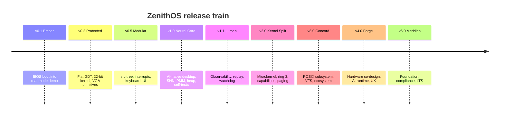

# ZenithOS Roadmap

> **Current release: v1.0 — "Neural Core".** A 32-bit x86, AI-native bare-metal
> operating system with a deterministic spiking-neural-network desktop.
> Everything below **v1.1** is a plan, not a shipped feature.

This roadmap is the public contract between the project and its users. It is
organised by *release train*, not by wishlist: each milestone has concrete
deliverables, measurable exit criteria, and a risk register. A milestone ships
only when every exit criterion in its section is satisfied; otherwise it is
re-scoped, not relabelled.

---

## Table of contents

- [Roadmap principles](#roadmap-principles)
- [Release train at a glance](#release-train-at-a-glance)
- [v0.1 — Bootstrap](#v01--bootstrap)
- [v0.2 — Protected-mode kernel](#v02--protected-mode-kernel)
- [v0.5 — Modular kernel + UI](#v05--modular-kernel--ui)
- [v1.0 — AI-native neural desktop (current)](#v10--ai-native-neural-desktop-current)
- [v1.1 — Observability and reliability](#v11--observability-and-reliability)
- [v2.0 — Microkernel](#v20--microkernel)
- [v3.0 — POSIX subsystem and ecosystem](#v30--posix-subsystem-and-ecosystem)
- [v4.0 — Hardware co-design, AI runtime, UX](#v40--hardware-co-design-ai-runtime-ux)
- [v5.0 — Foundation, governance, compliance](#v50--foundation-governance-compliance)
- [Non-goals](#non-goals)
- [Risk register](#risk-register)
- [Release engineering](#release-engineering)
- [How to influence this roadmap](#how-to-influence-this-roadmap)

---

## Roadmap principles

1. **No feature without a demo.** A merged feature must be observable in a
   screenshot, a log line, or a test assertion produced by the normal build.
2. **No milestone without falsifiable exit criteria.** "Better" is not a
   criterion. "`tools/emulate.mjs` asserts ≥ 24 distinct frame hashes across
   120 injected ticks" is.
3. **Reliability is a feature, not a phase.** Every milestone carries a static
   image check, a boot self-test, and a reproducible-build guarantee.
4. **The AI is part of the kernel, not an application.** From v1.0 onward, the
   neural model is a first-class kernel subsystem with deterministic semantics;
   later releases may shrink it, isolate it, or accelerate it, but they cannot
   make it non-deterministic.
5. **Honest boundaries.** The `v1.0` column describes only what the source
   implements today. Everything else is labelled *planned* and carries the
   milestone that will make it real.

---

## Release train at a glance

| Version | Codename | Theme | Status |
| --- | --- | --- | --- |
| v0.1 | *Ember* | BIOS boot into real-mode demo | Shipped |
| v0.2 | *Protected* | Flat GDT, 32-bit kernel, VGA primitives | Shipped |
| v0.5 | *Modular* | `src/` module tree, interrupts, keyboard, UI | Shipped |
| **v1.0** | **Neural Core** | **AI-native desktop, SNN, PMM/heap, self-tests** | **Current** |
| v1.1 | *Lumen* | Observability, reliability, deterministic replays | Planned |
| v2.0 | *Kernel Split* | Microkernel, ring 3, capabilities, paging | Planned |
| v3.0 | *Concord* | POSIX subsystem, VFS, package ecosystem | Planned |
| v4.0 | *Forge* | Hardware co-design, AI runtime, UX polish | Planned |
| v5.0 | *Meridian* | Foundation, global compliance, long-term support | Planned |

### The v1.0 architecture in one paragraph

The 512-byte boot sector loads the kernel from CHS sector 2 to physical
`0x10000`, captures the BIOS E820 map to `0x0500`, opens A20, switches VGA to
mode 13h (320×200×256), installs a flat 4 GiB GDT, and jumps into protected
mode. The modular kernel then builds a real IDT, remaps the 8259 PIC, starts the
8254 PIT at 100 Hz, and runs a deterministic 24-neuron spiking neural network
whose activations drive a 3D neon neural-mesh desktop on a double-buffered VGA
framebuffer. A physical page bitmap allocator, a free-list heap, a unified
serial-plus-ring-buffer logger, and boot self-tests complete the picture. There
is no paging, no userspace, no scheduler, no filesystem, no network, and no
persistent storage — and the documentation says so everywhere it matters.

---

## v0.1 — Bootstrap

**Theme:** prove that the machine can be made to execute our bytes.

### Deliverables

- `boot.asm` assembled as a 512-byte boot sector with `0xAA55` signature.
- BIOS text output via `INT 10h`, drive number captured from `DL`.
- Boot image exactly 1,474,560 bytes (1.44 MB), raw (no FAT dependency).
- `build.js` that shells out to NASM and pads the image.
- Failure paths: `DISK FAIL`, `A20 FAIL`, halted CPU.

### Exit criteria

- `node build.js` produces an image whose first 512 bytes end in `55 AA`.
- QEMU boots to the banner and halts deterministically.
- A deliberately corrupted NASM source makes the build fail non-zero.

### Risks at this stage

| Risk | Mitigation applied |
| --- | --- |
| Floppy geometry differs between BIOSes | CHS 0/0/2..18 is standard 1.44 MB geometry; image is padded |
| `DL` unreliable on some firmware | Saved immediately on entry, before any BIOS call |
| Boot sector overflows 512 bytes | `times 510-($-$$) db 0` plus an explicit size check in `build.js` |

---

## v0.2 — Protected-mode kernel

**Theme:** leave real mode behind without losing the screen.

### Deliverables

- A20 enablement through BIOS `INT 15h AX=2401h`, then the fast A20 gate at
  port `0x92`, each verified with the `0x0500`/`0x9010` aliasing test.
- VGA mode 13h selected *before* `CR0.PE` is set.
- Flat code (`0x08`) and data (`0x10`) descriptors covering 4 GiB.
- 32-bit entry at `0x10000` with `ESP = 0x9F000`.
- `rep movsd` blitter from a shadow framebuffer to `0xA0000`.

### Exit criteria

- Kernel executes 32-bit instructions and the screen is a stable colour field.
- No BIOS calls after the protected-mode far jump.
- Kernel binary fits inside the bootloader's CHS load window; `build.js`
  fails loudly when it does not.

### Risks at this stage

| Risk | Mitigation applied |
| --- | --- |
| A20 silently closed → memory aliasing | Two independent enable paths, each verified by a memory alias test |
| GDT descriptor mistakes triple-fault | Descriptors are static and checked by a boot self-test from v1.0 |
| Frame tearing | Shadow buffer + single contiguous blit |

---

## v0.5 — Modular kernel + UI

**Theme:** stop writing one file; start writing an operating system.

### Deliverables

- Source tree split into `src/arch/`, `src/drivers/`, `src/mm/`, `src/ui/`,
  `src/lib/`, and an umbrella `src/kernel.asm`.
- IDT with per-vector gates; exception stubs and IRQ stubs.
- 8259 PIC remapped to `0x20`/`0x28`, with mask and EOI helpers.
- 8254 PIT at 100 Hz driving a monotonic tick counter.
- IRQ1 keyboard driver: scancode set 1, ring buffer, key-state tracking.
- Back-buffered VGA primitives: pixel, line, rectangle, palette, text.
- 5×7 bitmap font (no BIOS font dependency) and a cyberpunk theme.
- Rotating wireframe/neural UI prototype.

### Exit criteria

- Interrupts are live: the tick counter advances and a keypress appears in the
  ring buffer without polling.
- The UI renders at a stable rate for several minutes under QEMU.
- Every module assembles independently through the build's compile gate.

---

## v1.0 — AI-native neural desktop (current)

**Codename:** *Neural Core.* **Theme:** a kernel whose observable state is a
perception loop.

### Deliverables (all present in the v1.0 source tree)

- **Boot path:** 512-byte sector; E820 capture to `0x0500`; A20 verified; VGA
  mode 13h; flat GDT; kernel at `0x10000` (up to 60 KiB through the CHS window).
- **Exception handling:** full IDT; named CPU exception vectors; panic screen
  with vector name, faulting `EIP`, and control registers.
- **Timing and input:** PIC remap, PIT at 100 Hz, IRQ1 scancode set 1 with a
  ring buffer, key state, and interrupt-driven camera control.
- **Memory:** E820-driven physical page bitmap allocator (`mm/pmm.asm`);
  free-list heap (`mm/heap.asm`).
- **AI:** deterministic 24-neuron spiking neural network (`ai/snn.asm`) fed by
  timer ticks and keyboard stimulus; its activations drive rendering.
- **UI:** 24 rotating 3D neurons (two rings, four axis nodes, four core nodes),
  40 synapse edges, 12 travelling data packets, a 72-star field, a perspective
  floor grid, scanline/cyberpunk palette, and a HUD (title, FPS, uptime,
  memory/PMM/heap statistics, SNN spike metrics, control hints).
- **Camera:** `W`/`S` dolly (zoom, clamped 130–560), `A`/`D` yaw, `Q`/`E`
  pitch (clamped ±6000), `R` reset, `C` toggle cinematic auto-rotation,
  `Space` boost, arrow keys mirroring zoom/yaw.
- **Libraries:** fixed-point math, string routines, unified logger
  (serial + in-memory ring, levels + timestamps, HUD-visible), boot self-tests.
- **Drivers:** VGA, keyboard, PIT, serial (COM1 16550), RTC (CMOS clock).
- **Build:** `node build.js`, zero npm dependency for the OS build; NASM
  discovery; generated 256-entry sine/cosine table; per-module compile gate;
  1.44 MB image assembly; boot-signature / size / kernel-budget / payload
  verification; SHA-256 printed.
- **Verification:** headless v86 boot harness (`tools/emulate.mjs`) that
  captures screenshots, injects WASD, and asserts a non-trivial frame.
- **CI:** GitHub Actions `build.yml`.

### Exit criteria (all satisfied for the v1.0 tag)

- `node build.js` succeeds on a clean Windows/Linux/macOS checkout with only
  Node + NASM installed, and prints a stable SHA-256 for identical sources.
- Image is exactly 1,474,560 bytes; boot sector is exactly 512 bytes and ends
  in `0xAA55`; kernel fits the bootloader window.
- 10 boot self-tests report boot-info/GDT/IDT/PMM/heap/SNN/RTC/PIT/VGA/`INT
  0x80` health.
- `node tools/emulate.mjs` boots headlessly, captures at least one frame, and
  validates that the frame is non-trivial (not a uniform colour field).
- A forced exception reaches the panic screen and prints a vector name.

### What v1.0 explicitly does **not** have

No paging or MMU isolation. No ring 3, no userspace, no processes. No
scheduler beyond hardware interrupt handlers. No filesystem, no persistent
storage. No networking. No POSIX syscalls (only the `INT 0x80` ABI groundwork).
Single CPU; no SMP, no ACPI, no power management. No audio. No USB. No dynamic
loading. Do not plan around these existing; plan around the milestones that
introduce them.

---

## v1.1 — Observability and reliability

**Theme:** make the loop measurable, replayable, and hard to break.

### Deliverables

- **Deterministic replay:** record `(tick, scancode)` event traces and replay
  them to reproduce any frame bit-for-bit; ship a trace fixture in `tools/`.
- **Structured logs:** stable event IDs, hexdump viewer on the panic screen,
  log ring persistence across a warm reset (where hardware allows).
- **Crash forensics:** register/stack dump, backtrace through a frame-pointer
  chain, symbol map generated at build time (`kernel.map`), panic hash.
- **Watchdog:** detect stalled main loop against the 100 Hz tick and render a
  "kernel stalled" overlay instead of a frozen screen.
- **Boot-time TSC calibration:** replace tick-only timing with a calibrated
  timestamp where the CPU exposes a TSC.
- **Regression dashboard:** CI publishes frame hashes and screenshot diffs as
  artifacts; a golden set of frames is committed.
- **Fault injection:** deliberate `#DE`, `#UD`, and bad-page tests behind a
  build flag, asserting the panic screen text.

### Exit criteria

- A recorded trace replays to identical PNG hashes on two different hosts.
- The watchdog fires within 500 ms of an injected infinite loop.
- Panic output includes vector, `EIP`, `CR0/CR2/CR3`, and a stable hash.
- CI fails on any regression in the golden frame set.

### Risks

| Risk | Mitigation |
| --- | --- |
| Frame hashes brittle across emulator versions | Pin the v86 version; hash structural assertions (palette histogram, edge count) alongside exact pixels |
| Replay drift | All state changes must flow through the event queue; enforced by self-tests |
| Flash/ROM persistence not available | Log snapshots are best-effort; never promise durable storage |

---

## v2.0 — Microkernel

**Theme:** split the kernel into a trusted core and untrusted servers.

### Deliverables

- **Paging:** 32-bit two-level page tables, per-address-space directories,
  guard pages, W^X mappings.
- **Ring 3:** user/kernel transitions through a validated trap gate; syscall
  entry on `INT 0x80` with a versioned ABI table.
- **Capability model:** unforgeable handles, rights masks, grant/revoke,
  per-object access checks; no ambient authority.
- **IPC:** synchronous message passing (send/receive/reply) with copy-in/copy-
  out validation and bounded queues.
- **Userspace servers:** display server (owns VGA), input server, logger
  server, memory broker, device server skeleton.
- **Scheduler:** preemptive round-robin/FIFO over user threads on the single
  CPU; timer-driven preemption; priorities.
- **Kernel object model:** threads, address spaces, endpoints, capability
  slots, reference counts.
- **Formal invariants in tests:** no kernel write to user memory without
  validation; all syscalls return typed errors.

### Exit criteria

- A buggy userspace process can be killed without destabilising the kernel.
- `mmap`-style allocation in two processes is isolated under test (write in one
  is not observed in the other).
- Message-passing ping-pong ≥ 20,000 round trips/second under QEMU (measured,
  median of 5 runs, methodology documented in the test log).
- The display server renders the neural desktop while a second server runs.
- Every syscall has a table entry, an argument validator, and a test.

### Risks

| Risk | Mitigation |
| --- | --- |
| IPC performance falling off a cliff | Measure per release; batch replies; keep the fast path copy-only |
| Capability complexity leaking everywhere | One typed handle API; no raw pointers across the boundary |
| Ring-3 switch correctness | Exhaustive tests for bad segments, bad stack, bad pointers |
| Larger kernel loses the "readable in one sitting" property | Trusted core capped at 64 KiB; servers separate |

---

## v3.0 — POSIX subsystem and ecosystem

**Theme:** run real software without becoming a general-purpose blob.

### Deliverables

- **VFS:** in-memory VFS plus a persistent read-only FS image (e.g. a compact
  squashfs-like format) on floppy/IDE; mount points; path resolution; open
  file descriptions.
- **Process model:** `fork` (copy-on-write via paging), `exec`, `wait`, `exit`,
  `kill`, process groups and sessions.
- **Signals:** a POSIX-compatible subset with default actions and handlers.
- **POSIX 2008 subset:** libc-facing syscalls for files, processes, pipes,
  time, and terminals; documented conformance list with per-call status.
- **C library:** port musl (preferred) or newlib on top of the syscall ABI;
  ship a hello-world and a coreutils subset as the reference workload.
- **Shell and userland:** a minimal shell, `ls`, `cat`, `echo`, `ps`, `kill`,
  `sh` scripts.
- **Package format:** signed `.zpkg` archives and a `zpkg` installer; offline
  repository format.
- **Ecosystem programme:** example drivers, a "first server" tutorial, and a
  compatibility badge for third-party ports.

### Exit criteria

- musl's test suite passes an agreed subset; every failure is documented in
  `docs/POSIX-COMPATIBILITY.md`.
- `fork`/`exec`/`wait` pipeline (`ls | cat`) runs in the shell.
- A package installs from a local repository and runs after reboot from a
  writable image.
- At least three third-party programs run unmodified on the POSIX layer.

### Risks

| Risk | Mitigation |
| --- | --- |
| POSIX scope creep | Only ship the documented subset; track a conformance matrix |
| Filesystem data loss | Read-only root by default; journal metadata before enabling writes |
| Ecosystem too small | Tutorials, porting grants (in time or recognition), CI port checks |
| Licence contamination | musl is MIT; package metadata enforces licence fields |

---

## v4.0 — Hardware co-design, AI runtime, UX

**Theme:** the OS and the machine are designed together.

### Deliverables

- **Hardware co-design programme:** a public device abstraction (ZenithBus)
  covering a reference board, accelerated framebuffer, timer, and NPU block;
  open register specifications and a QEMU device model for each.
- **AI runtime:** an on-device inference runtime for small deterministic models
  (int8 activation, fixed-point kernel operators), with model signing and a
  memory budget negotiated through the microkernel.
- **SNN v2:** learnable synapses (STDP) with deterministic seeds, auditable
  activation traces, and a documented inference contract.
- **UX:** a compositor with damage tracking, animation timing on the PIT/TSC,
  accessibility modes (large text, reduced motion, high contrast), and a
  keyboard-first command palette.
- **Power:** ACPI-based shutdown/reboot, CPU idle states, thermal-aware frame
  scheduling.
- **SMP:** bring-up of a second CPU core with per-core run queues and IPIs.

### Exit criteria

- A model signed by the build can be loaded, run, and audited on the NPU
  model under QEMU; its output is deterministic across runs.
- Accessibility modes are covered by screenshot regression tests.
- SMP boots, schedules user threads on both cores, and passes stress tests.
- Documented power transitions (S5 shutdown, idle) work on the reference board.

### Risks

| Risk | Mitigation |
| --- | --- |
| Hardware co-design without fab access | Emulate every device in QEMU first; keep FPGA path open |
| AI runtime bloat | Hard memory ceiling; capability-gated model loading |
| UX regressions | Screenshot + interaction regression suite gates every merge |
| SMP race bugs | Lockdep-style assertions in debug builds; stress tests in CI |

---

## v5.0 — Foundation, governance, compliance

**Theme:** make the project durable beyond its founders.

### Deliverables

- **Legal entity:** a non-profit foundation holding trademarks and assets.
- **Governance:** elected technical steering committee, public RFC archive,
  maintainer ladder, conflict-of-interest policy.
- **Compliance programme:** documented mapping for GDPR data-minimisation,
  accessibility, licence hygiene, and export controls; independent security
  audits.
- **Sustained funding:** grants/sponsorship policy, funded security work,
  internship pipeline.
- **LTS:** long-term-support branches with guaranteed security backports and
  reproducible builds.
- **Globalisation:** translated docs (`docs/i18n/`), regional community
  chapters, inclusive Contributor Covenant enforcement.

### Exit criteria

- A published foundation charter and a TSC elected by public process.
- Two independent reproducible builds attest to the same SHA-256.
- Annual security audit published with tracked remediation.
- At least three LTS consumers with documented support agreements.

---

## Non-goals

These are **not** on the roadmap, and the project should say no to them:

- Becoming a general-purpose desktop competitor to Linux/Windows. ZenithOS is
  a testbed for AI-native, reliability-first kernel design.
- Binary compatibility with Windows or macOS.
- Shipping proprietary blobs in the default image.
- Network-facing services in the default build before v3.0 hardening.
- Distributed consensus, server-class scalability, or multi-tenant isolation
  before v2.0 capabilities exist.
- Promising certifications (SOC 2, ISO 27001, IEC 62443) on the v1.x
  timeline; see `docs/COMPLIANCE.md` for aspirational language.

---

## Risk register

Project-level risks, reviewed at each release. Likelihood/impact are
qualitative: H/M/L.

| # | Risk | L | I | Mitigation | Owner |
| --- | --- | --- | --- | --- | --- |
| R1 | Bootloader CHS geometry breaks on exotic firmware | M | H | Standard 1.44 MB geometry; LBA/EDD second stage planned for v1.1 | Boot maintainer |
| R2 | Kernel outgrows the load window | H | M | 60 KiB budget enforced by `build.js`; per-module size budget in CI | Kernel maintainer |
| R3 | Frame budget misses on slow emulators | M | M | Render work bounded per frame; FPS shown in HUD; degrade path planned | UI maintainer |
| R4 | Determinism drift in SNN | M | H | All randomness from fixed seeds; replay tests in v1.1 | AI maintainer |
| R5 | Panic path itself faults | M | H | Panic code is minimal, no heap, no locks; tested via fault injection | Kernel maintainer |
| R6 | Reproducible build breaks | M | H | Deterministic assembler only; SHA-256 checked per build; pins documented | Build maintainer |
| R7 | Bus factor | H | H | Documentation-first culture; two reviewers per subsystem; roadmap in repo | Lead |
| R8 | Scope creep into general-purpose OS | H | M | Non-goals list; RFC review for every new subsystem | TSC |
| R9 | Security disclosure mishandled | L | H | Private reporting channel; 90-day policy in SECURITY.md | Security maintainer |
| R10 | License contamination from third-party code | M | H | Provenance checks in review; SPDX headers; SBOM generation planned | Legal/maintainers |

---

## Release engineering

- **Branching:** `main` is always buildable; release tags are annotated
  (`v1.0.0`) with a commit hash and SHA-256 of `zenithos.img`.
- **Version semantics:** `MAJOR.MINOR.PATCH` where `MAJOR` is an architecture
  epoch (kernel split, POSIX, hardware), `MINOR` a feature train, `PATCH` a
  fix-only release. A BIOS-to-UEFI change or a kernel/userspace split is a
  major bump.
- **Cadence:** feature trains every 6–9 months once v1.1 lands; security fixes
  as needed; an LTS tag every 24 months from v3.0.
- **Artifacts (v1.0):** `zenithos.img`, `boot.bin`, `kernel.bin`,
  `build/report.json` (hashes + checks), and screenshots. Planned additions:
  `SHA256SUMS` and `kernel.map`.
- **Gate:** the required CI job (`build.yml` → build) must pass assembler
  success, image validation, and artifact upload. The headless boot/frame
  assertion runs as an advisory visual job in v1.0 and becomes required in
  v1.1.
- **Deprecation:** syscall ABI entries are versioned; removal requires one
  minor release of warnings logged through the unified logger.

---

## How to influence this roadmap

1. Read `docs/GOVERNANCE.md` and open an RFC issue using the template.
2. Small changes (docs, tests, driver tweaks) can go straight to a pull
   request.
3. Architecture changes (new subsystem, ABI change, memory-model change)
   require an accepted RFC and a working prototype behind a build flag.
4. Roadmap edits are reviewed by the maintainers in the weekly triage and land
   with a changelog entry.

---

*ZenithOS roadmap — ship small, ship honest, ship the loop.*
