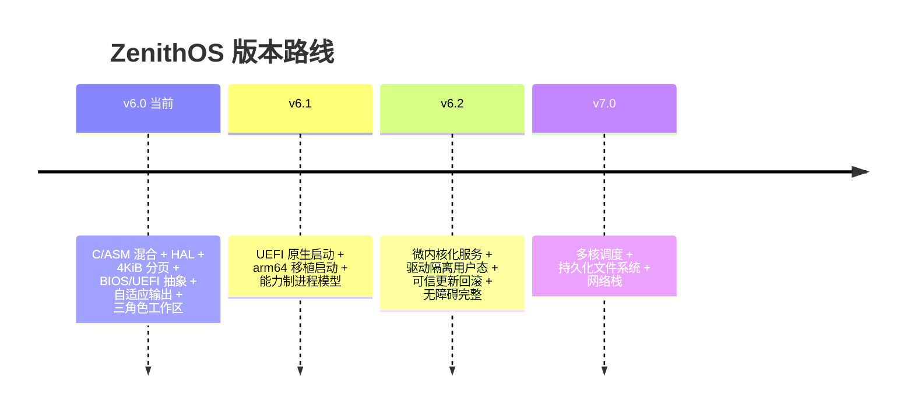

# ZenithOS 路线图（Roadmap）

> **当前版本：v6.0**。这是一个从旧「全 NASM、单地址空间」架构到「C/ASM 混合、HAL 分层、
> 4 KiB 分页、多设备」架构的**重写里程碑**。本文件是项目与其用户的公开契约：每个里程碑给出
> 可交付物、可证伪的退出标准与风险登记，只有满足全部退出标准才会发布，否则重新划界而非改名。

关联文档：[README.md](README.md)（概览）、[docs/ARCHITECTURE.md](docs/ARCHITECTURE.md)（架构）、
[docs/SECURITY.md](docs/SECURITY.md)（安全）、[docs/ECOSYSTEM.md](docs/ECOSYSTEM.md)（生态）。

---

## 目录

- [路线图原则](#路线图原则)
- [版本总览](#版本总览)
- [v6.0 — C/ASM 混合与 HAL（当前）](#v60--casm-混合与-hal当前)
- [v6.1 — UEFI/arm64 启动与能力制进程](#v61--uefiarm64-启动与能力制进程)
- [v6.2 — 微内核化与可信更新](#v62--微内核化与可信更新)
- [v7.0 — 多核、持久化与网络](#v70--多核持久化与网络)
- [非目标](#非目标)
- [风险登记](#风险登记)
- [发布工程](#发布工程)
- [如何影响本路线图](#如何影响本路线图)

---

## 路线图原则

1. **无演示不合并。** 合并的特性必须能在截图、日志行或测试断言中观察到。
2. **无里程碑不立可证伪退出标准。** 「更好」不是标准；“`tools/emulate.mjs` 断言非空帧 +
   串口 `booting` 日志”才是。
3. **可靠性是特性，不是阶段。** 每个里程碑都携带静态镜像校验、启动日志断言与可复现构建保证。
4. **机制与策略分离。** 任何新机制（分页、中断、驱动）必须有一个可配置的策略落点
   （`src/include/config.h`），不允许把频率、映射范围等硬编码进机制代码。
5. **诚实边界。** 「当前」列只描述仓库源码今天实现的内容；其余一律标注「规划」并携带对应里程碑。

---

## 版本总览

| 版本 | 主题 | 状态 |
| --- | --- | --- |
| **v6.0** | C/ASM 混合、HAL、4 KiB 分页、BIOS/UEFI 抽象、自适应输出、三角色工作区、文档 | **当前（重写中）** |
| v6.1 | UEFI 原生启动、arm64 移植启动、能力制进程模型 | 规划 |
| v6.2 | 微内核化服务、驱动隔离用户态、可信更新/回滚、无障碍完整实现 | 规划 |
| v7.0 | 多核调度、持久化文件系统、网络栈 | 规划 |

---

## v6.0 — C/ASM 混合与 HAL（当前）

**主题：** 把内核从「单文件 NASM 镜像」重构为「C(TCC) + ASM(NASM) 混合、HAL 分层、可派生」的骨架。

### 交付物

- **C/ASM 混合构建。** `src/**/*.{c,asm}` 由 TCC（`-c`）编译 C、NASM（`-f elf32`）汇编 ASM，
  二者产出 ELF32 可重定位对象；**GNU `ld`** 用 `build.js` 生成的 `kernel.ld` 脚本完成全部符号解析
  与重定位（mingw 宿主上以 `--image-base ORG-0x1000` 输出 PE），再由 **`objcopy -O binary`**
  平坦化产出 `kernel.bin`（`_start` 必须位于偏移 0）。构建脚本不自造链接器。
- **HAL。** `src/hal/hal.h` + `src/hal/x86/{port,cpu}.{h,asm}`：端口 I/O（`outb/inb/outw/inw/outl/inl/io_wait`）
  与 CPU 控制（`cli/sti/hlt/rdtsc/CR0/CR2/CR3 读写/invlpg/lgdt/lidt`）。
- **架构层。** `src/arch/arch.h` + `src/arch/x86_32/{arch.h,gdt,idt,isr,pic}.{c,h,asm}`：
  GDT/IDT/ISR/PIC；`src/arch/arm64/{arch.h,README.md}` 为接口骨架（仅头文件/文档，不参与 x86 编译）。
- **4 KiB 分页。** `src/mm/{mm.h,pmm,paging,heap}.{c,h}`：位图物理页分配器（`0x30000`，16 KiB，
  131,072 页覆盖 512 MiB）、分页（页目录 `0x71000`、恒等映射页表 `0x72000` 覆盖前 16 MiB + 启用；
  堆末尾 `0x70000` 与页目录之间保留 4 KiB 隔离保护页，防止 bump 堆越界踩坏 MMU 状态）、
  内核堆（`0x34000`…`0x70000`）。
- **BIOS/UEFI 抽象。** `boot/bios/boot.asm` 已实现（A20/E820/CHS/模式 13h/写 BootInfo/进保护模式）；
  `boot/uefi/` 提供移交规范接口骨架（`BootInfo.boot_type=1`），暂不编译。
- **自适应输出。** 内核依据 `BootInfo.video_mode`（`0x13`/`0x03`/`0x00`）与 `BootInfo.flags`
  （`VGA|KEYBOARD|HEADLESS|SERIAL`）选择输出路径：VGA 帧缓冲 / 文本 / 串口 / 无头。
- **三角色工作区。** `src/ui/{font,theme,desktop,terminal,roles,scene3d}`：通用桌面↔终端热切换、
  开发者模式（内存页/寄存器查看）、创作者模式（3D 线框视觉）。
- **文档。** README、ROADMAP、docs/ARCHITECTURE、docs/SECURITY、docs/ECOSYSTEM。

### 退出标准

- `node build.js` 在仅安装 Node 18+ / NASM 2.13+ / TCC 0.9.27 i386 的干净检出上成功，并对相同源码
  打印稳定 SHA-256。
- `boot.bin` 恰为 512 字节且以 `0xAA55` 结尾；`kernel.bin` 不超过 60 KiB 引导窗口；镜像恰为
  1,474,560 字节且回读校验通过。
- 内核在 v86 无头环境下：串口输出 `ZenithOS v6.0 [x86_32] booting...`，VGA 帧非空（非单色域）。
- `BootInfo` 校验通过：`magic=0x4F4E455A`、`version=6`；E820 描述符 `e820_count ≤ 24` 且类型/边界合法。

### 当前实现现状（诚实）

仓库今天已经通过退出标准的子集：BIOS 引导、BootInfo 移交、`kernel_main` C 入口存活、
HAL 的 port/cpu、字符串库、完整构建/链接/打包管线（GNU `ld` + `objcopy`，镜像在 v86 无头
串口/帧捕获下可回放）。IDT/PIC/ISR 与 PS/2 键盘中断已经打开（IRQ1→键盘、IRQ0→100 Hz 节拍），
之上运行**交互式 Shell**（提示符/回显/Backspace/Enter + `help`/`clear`/`reboot`/`3d` 命令，
`3d` 进入 Q8.8 定点旋转的 3D 神经网格演示、ESC 返回 Shell）。`[已编译·未接线]`：PMM/分页/堆、
rtc/device、`lib/{fmt,log,panic}`。`[目标架构]`（未创建文件）：UI 的
theme/desktop/terminal/roles/scene3d 与三角色工作区交互。启用分页与 UI 是 v6.0 自身的剩余工作。

---

## v6.1 — UEFI/arm64 启动与能力制进程

**主题：** 打开第二路径（UEFI、arm64）的第一块真实砖，并在分页之上建立最小的能力制进程模型。

### 交付物

- **UEFI 原生启动。** 将 `boot/uefi/` 从接口骨架推进为可编译的 64 位 UEFI 应用：探测
  `E820` / UEFI 内存映射，获取 GOP 帧缓冲（`video_mode` 记录），写 `BootInfo.boot_type=1`，退出
  Boot Services 后进入 32 位保护模式内核（与 BIOS 路径共用 `KERNEL_ORG=0x10000` 约定）。
- **arm64 移植启动。** 将 `src/arch/arm64/{arch.h,README.md}` 从接口定义推进为可启动骨架：
  等价 HAL 原语（`cli/sti/hlt/CRx 对应/invlpg 对应/屏障`）与 `BootInfo` 生产路径，先在 QEMU
  `-M virt` 下进入 C 入口。
- **能力制进程模型。** 以 v6.0 分页为基础：页目录/页表为每个进程建立独立地址空间；能力句柄
  （不可伪造的 handle + 权限掩码 + 授予/回收）作为唯一授权机制；最小调度（单核轮转/协作）。

### 退出标准

- UEFI 镜像与 BIOS 镜像都能引导到同一 `kernel_main`，且打印相同串口横幅（`boot_type` 分别为 `1`/`0`）。
- arm64 骨架在 QEMU `-M virt` 下进入 C 入口并输出平台标识。
- 两个进程的地址空间相互隔离（在一个进程写不扰动另一进程）；所有资源访问经能力检查；退出标准
  由 `docs/ARCHITECTURE.md` 的能力章节与自动化断言共同证明。

### 风险

| 风险 | 缓解 |
| --- | --- |
| UEFI 64→32 位移交复杂 | 定义统一 `BootInfo` 移交契约；UEFI 层可读、可替换、暂不优化 |
| arm64 与 x86 语义漂移 | 统一 HAL 头文件为唯一契约；每端口自带自检 |
| 能力制引入内核膨胀 | 能力表走固定槽位 API；信任核代码量设硬上限 |

---

## v6.2 — 微内核化与可信更新

**主题：** 把驱动与子系统从内核迁出，进入隔离用户态服务；并让系统可自我更新且可回滚。

### 交付物

- **微内核化服务。** 在内核外运行的用户态服务进程（显示、输入、日志），经能力制 IPC 与内核交互；
  内核只保留机制（调度、IPC、能力、页表、中断投递）。
- **驱动隔离用户态。** 将 `src/drivers/`（keyboard/pit/rtc/device 等）迁为受能力约束的用户态驱动
  进程，物理端口/MMIO 由内核按能力窗口代理或授权。
- **可信更新/回滚。** 镜像签名、A/B 槽位、启动时校验失败回滚到上一已知良好镜像（依赖持久化存储
  最小能力，见 v7.0）。
- **无障碍完整实现。** 补齐四角色工作区的第四个角色：极高对比度纯文本大字体面板、系统健康监控，
  并使切换可经键盘一手完成。

### 退出标准

- 一个故障的用户态驱动可被杀死而不影响内核稳定（内核不因驱动崩溃而 panic）。
- 显示服务在渲染桌面的同时，第二个服务仍正常运行（IPC 实测数据写入测试日志）。
- 更新镜像签名校验失败时自动回滚并成功引导上一镜像。
- 无障碍面板在纯文本大字体下可读，且健康监控覆盖 CPU/内存/中断核心指标。

### 风险

| 风险 | 缓解 |
| --- | --- |
| IPC 性能断崖 | 每版本实测往返时延；快路径仅拷贝 + 批量应答 |
| 驱动迁出后调试困难 | 每个用户态驱动自带单一职责边界与可重放日志 |
| 回滚需持久存储 | 以只读优先、A/B 最小扇区数实现；与 v7.0 文件系统解耦 |

---

## v7.0 — 多核、持久化与网络

**主题：** 从单核研究原型走向多核、可持久、可联网的完整系统。

### 交付物

- **多核调度。** SMP 启动（AP 引导、per-CPU 数据结构、IPI）、跨核调度与负载均衡。
- **持久化文件系统。** 最小持久化文件系统与块设备驱动，支持只读根、元数据校验。
- **网络栈。** 最小网络栈（链路/IP 基础），默认关闭、经能力门控，解析器按安全规范优先模糊测试。

### 退出标准

- 多核启动后线程在两核上正确调度并通过压力测试（无数据竞争，锁序经断言）。
- 文件系统在重启后数据一致（掉电场景下元数据可恢复或有明确只读承诺）。
- 网络栈对外无默认监听；能力门控决定谁可创建套接字；解析器在 fuzz 下无未处理崩溃。

### 风险

| 风险 | 缓解 |
| --- | --- |
| SMP 竞态难复现 | 调试构建加锁序断言；CI 压力测试 |
| 文件系统数据丢失 | 只读根 + 写前日志元数据；发布前数据完整性门禁 |
| 网络扩大攻击面 | 默认关闭、能力门控、解析器先行 fuzz |

---

## 非目标

这些**不在**路线上，项目应对其说「不」：

- 成为 Linux/Windows 的通用桌面替代品。ZenithOS 是可靠性优先、多设备一致的微内核化研究试验台。
- 与 Windows / macOS 二进制兼容。
- 默认镜像内分发专有固件。
- 在 v6.2 能力制与隔离落地之前开放面向网络的默认服务。
- 在具备可验证隔离（v6.2）之前宣称多租户或服务器级可扩展性。
- 在本时间线上宣称任何合规/安全认证（见 `docs/SECURITY.md` 的诚实边界）。

---

## 风险登记

| # | 风险 | L | I | 缓解 | 责任域 |
| --- | --- | :-: | :-: | --- | --- |
| R1 | BIOS CHS 几何在异常固件上失败 | M | H | 标准 1.44 MB 几何；UEFI 路径在 v6.1 提供第二路线 | 引导维护者 |
| R2 | 内核超出 60 KiB 窗口，或 C 库体积失控 | H | M | `build.js` 强制预算；每模块体积门禁入 CI | 内核维护者 |
| R3 | 宿主 binutils 只能输出 PE（mingw），平坦化依赖 `objcopy -O binary` | M | H | 链接脚本固定 `. = KERNEL_ORG` + `--image-base ORG-0x1000`；CI 在 Linux 用原生 ELF ld 覆盖第二条路径；`nm` 回读 `_start` 入口 | 构建维护者 |
| R4 | 多设备 HAL 语义漂移（x86 与 arm64） | M | H | 统一 HAL 头文件为唯一契约；每端口自检 | HAL 维护者 |
| R5 | 分页恒等映射忘开/误开导致三位故障 | M | H | 页目录/页表静态布局；启动自检身份映射 | 内存维护者 |
| R6 | 能力制/微内核化引入膨胀，失去「可读」 | M | M | 信任核代码量硬上限；服务独立 | 架构维护者 |
| R7 | 可复现构建破坏 | M | H | 确定性工具链；每构建打印 SHA-256；版本锁定 | 构建维护者 |
| R8 | 安全披露处理不当 | L | H | 私有上报渠道；90 天政策见 `docs/SECURITY.md` | 安全维护者 |
| R9 | 第三方代码许可污染 | M | H | 来源检查、SPDX 头；SBOM 规划 | 维护者/法务 |

---

## 发布工程

- **分支：** `main` 始终可构建；发布标签为带注释标签（含提交哈希与 `zenithos.img` SHA-256）。
- **语义：** `MAJOR.MINOR.PATCH`，`MAJOR` 为架构纪元（微内核拆分、多核），`MINOR` 为特性列车。
  BIOS→UEFI、内核/用户态拆分、多核均为 `MAJOR`。
- **节奏：** 重写期按可验证里程碑推进；发布贴有退出标准门禁；安全修复按需。
- **产物（v6.0）：** `zenithos.img`、`build/boot.bin`、`build/kernel.bin`、`build/report.json`、截图。
- **门禁：** CI（`.github/workflows/build.yml`）必须通过工具链发现、编译/汇编、链接、镜像校验；
  v86 无头启动 + 帧断言为随附验证任务。

---

## 如何影响本路线图

1. 阅读 `docs/ECOSYSTEM.md`（开放治理）与 `docs/ARCHITECTURE.md`，用议题/评审流程提出变更。
2. 小改动（文档、测试、常量调整）可直接提 PR。
3. 架构变更（新子系统、ABI 变更、内存模型变更）需书面提案 + 可运行原型（可置于构建开关之后）。
4. 路线图编辑由维护者评审，合并时带变更记录。

---

*ZenithOS 路线图 —— 小步交付，诚实交付，把机制与策略分开交付。*
